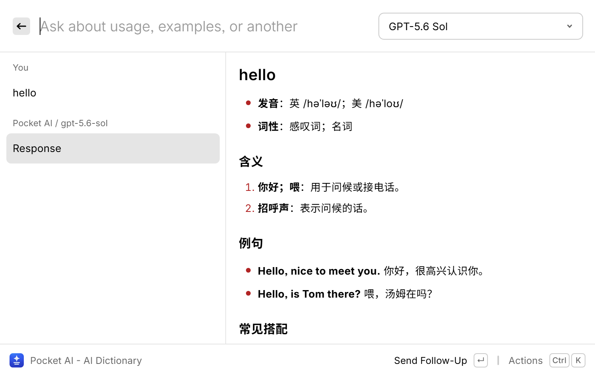
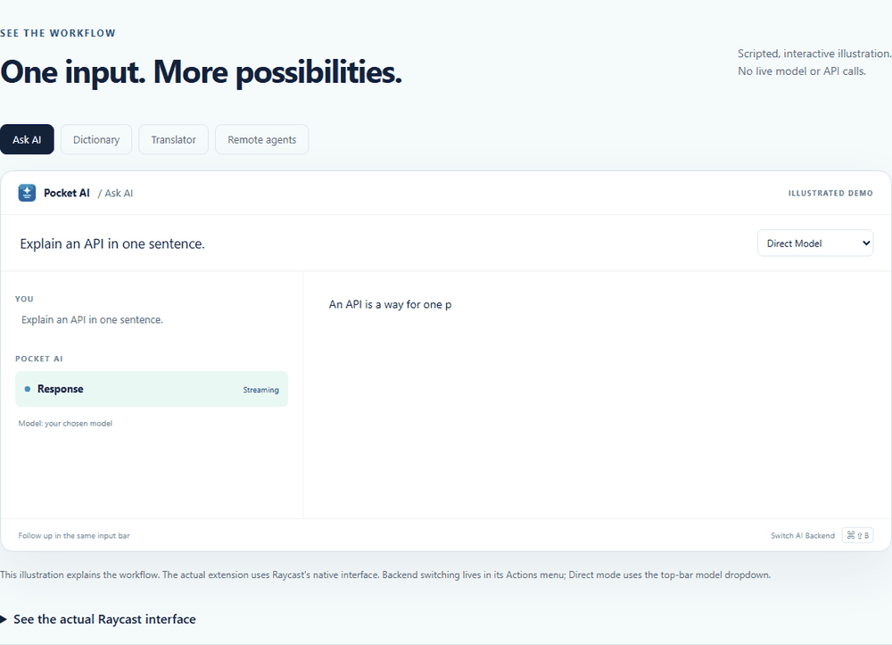

# Pocket AI for Raycast

**An open-source Raycast AI alternative for macOS and Windows. No Raycast Pro required.**

Ask questions, look up words, translate, and polish writing without opening another app. Replies stream beneath the input bar, and follow-up questions stay in the same conversation. Pocket AI uses your OpenAI-compatible provider, not Raycast's paid AI API.

[**Install on Mac**](INSTALL-MACOS.md) · [**Install on Windows**](#install-on-windows) · [**Website & interactive demo**](https://edliuustc.github.io/pocket-ai-raycast/) · [**Setup guides**](https://edliuustc.github.io/pocket-ai-raycast/guides.html)

The extension is free and MIT-licensed. **Provider usage, subscriptions, and remote hosting are separate.** Bring your own accessible models, or connect Ask AI to your own Hermes/OpenClaw agent. Pocket AI does not unlock Raycast Pro features.

[](LICENSE)

## See it in action



_Genuine Windows Raycast capture using the sample query "hello". macOS uses Raycast's native appearance; the project owner verified the Mac Raycast V1 workflow through v1.3.0._



_30-second scripted website illustration, not a native Raycast recording. [Try the interactive demo](https://edliuustc.github.io/pocket-ai-raycast/#demo)._

## What it does

- **One input bar:** type your query in Raycast, not a separate form.
- **Rich output by default:** streamed Markdown and image URLs render directly in the native preview, without opening another view. Switch to full-width text from Actions.
- **Streaming conversations:** responses arrive progressively; follow-ups retain context.
- **Bring your own provider:** configure a base URL and optional API key. A VS Code Copilot bridge can be used if you already have one.
- **Remote harnesses:** optionally use Ask AI as a streaming frontend for your own Hermes or OpenClaw agent, with server-owned sessions, tool activity, approvals, and cancellation.
- **One agent settings screen:** the Remote Agents command and home dashboard share the saved backend/server configuration. Native preferences keep secure keys, not a second backend selector.
- **Switch inside Ask AI:** use **Actions > Switch AI Backend** or **Command+Shift+B** (Mac) / **Ctrl+Shift+B** (Windows). Direct shows the model dropdown; Hermes/OpenClaw show their agent profiles. The saved mode stays consistent with Remote Agents.
- **Model dropdown:** discover and select the models your provider exposes.
- **Ready-made commands:** Ask AI, Dictionary, Translator, and Polish Text.
- **Your own commands:** create from templates; customize prompts, placeholders, models, and endpoint overrides.
- **Comfortable reading:** use **Ctrl+L** (Windows) / **Command+L** (Mac) to pause following before browsing older content, then resume when ready.
- **Pocket AI Settings:** edit, add, delete, and restore built-in commands.
- **Your shortcuts:** assign aliases and hotkeys; expose custom commands through Raycast Quicklinks.

## Requirements

| Requirement   | Details                                                                                                                                                                       |
| ------------- | ----------------------------------------------------------------------------------------------------------------------------------------------------------------------------- |
| Platform      | Windows desktop workflows are verified. The project owner verified Mac Raycast V1 through v1.3.0, including in-tool backend switching. See the [Mac guide](INSTALL-MACOS.md). |
| Raycast       | Install, open, and sign in before installing Pocket AI. A free account is sufficient for this extension.                                                                      |
| Node.js + npm | Stable Node.js **22.22.2 or newer** with npm; the Windows installer needs `npm.cmd` next to `node.exe`.                                                                       |
| AI provider   | An accessible OpenAI-compatible API with chat completions and model discovery. Provider access or subscriptions are separate.                                                 |

Pocket AI does not install Raycast, install a provider, purchase subscriptions, or supply API credentials.

## Install on Mac

Follow [INSTALL-MACOS.md](INSTALL-MACOS.md) for source import, production build, provider/agent setup, Mac shortcuts, updates, and verification. The plugin runtime has no Windows-only shell or filesystem dependency; macOS shortcuts are included. The project owner reported successful Mac Raycast V1 verification through v1.3.0. This Windows development environment was not used to perform that Mac check. Do not run the Windows PowerShell installer on a Mac.

## Install on Windows

### Download and install

1. Download `pocket-ai-windows-source.zip` from [Releases](https://github.com/edliuustc/pocket-ai-raycast/releases), or choose **Code > Download ZIP**.
2. Extract it into a permanent folder. Open PowerShell in the folder containing `package.json` and `install.ps1`.
3. Keep Raycast running and signed in, then run:

```powershell
powershell.exe -NoProfile -ExecutionPolicy Bypass -File .\install.ps1
```

`-ExecutionPolicy Bypass` applies to this process only; no persistent policy change is needed.

The installer checks prerequisites, installs locked dependencies, requests source import using the Raycast CLI, stops the development process it started, and verifies a persistent production build. It finishes with JSON:

```json
{
  "status": "installed",
  "version": "1.3.0",
  "commands": 9,
  "watcherRunning": false,
  "uiVerification": "required"
}
```

The actual JSON also includes installation paths and the next step. A nonzero exit code or `"status": "failed"` means installation did not complete.

4. Open **Pocket AI Settings** from Raycast search. Choose **AI Provider**, configure your endpoint/key, then open **Ask AI**, choose a model, and send a short test question.

An installer success verifies build files and import initiation, not your provider credentials or the final Raycast UI. The test question completes end-to-end verification.

### Install with Git

```powershell
git clone https://github.com/edliuustc/pocket-ai-raycast.git
Set-Location .\pocket-ai-raycast
powershell.exe -NoProfile -ExecutionPolicy Bypass -File .\install.ps1
```

### Installer options

```powershell
# Explicit Node location, including paths containing spaces:
powershell.exe -NoProfile -ExecutionPolicy Bypass -File .\install.ps1 -NodePath "C:\Program Files\nodejs\node.exe"

# A network's approved HTTPS npm mirror:
powershell.exe -NoProfile -ExecutionPolicy Bypass -File .\install.ps1 -Registry "https://your-approved-npm-registry.example"

# Build and check without importing or modifying the installed extension:
powershell.exe -NoProfile -ExecutionPolicy Bypass -File .\install.ps1 -BuildOnly
```

Rerunning the installer preserves Raycast's saved provider preferences and tool storage. Dependencies are restored when the source manifests change. Keep the checkout for updates.

### Manual fallback

If you prefer the standard developer workflow:

```powershell
npm.cmd ci
npm.cmd run dev
```

Wait for Pocket AI to appear in Raycast, press **Ctrl+C** in that terminal, then run:

```powershell
npm.cmd run build
```

Close the terminal afterward. If another developer session is active, stop that session yourself before rerunning the automated installer.

**Windows bundle limitation:** Raycast Windows **2.11.0.0**, the build verified for this project, restricts direct `.rayext` bundle import to internal builds. Use a source ZIP or Git checkout, not a double-click on `.rayext`. A newer Raycast release may change this.

## Connect your provider

Run **Configure AI Provider**, or select **AI Provider** in **Pocket AI Settings**.

| Field        | What to enter                                                                                               |
| ------------ | ----------------------------------------------------------------------------------------------------------- |
| API Endpoint | Your OpenAI-compatible base URL, such as `https://api.example.com/v1`, or its full `/chat/completions` URL. |
| API Key      | Your provider's key, without `Bearer`. Leave blank only when the provider requires no authentication.       |

Models are discovered from `<base>/models`. The optional local bridge route `/api/openai/v1` uses `/api/v1/lm/chatModels` for discovery.

The default endpoint is `http://127.0.0.1:23333/api/openai/v1`. It expects a separately running local VS Code Copilot bridge. **On another computer, including a Mac, `127.0.0.1` refers to that computer.** Set up and sign into your bridge there, or change the endpoint.

No bridge implementation, GitHub Copilot credentials, or provider access is bundled with Pocket AI. Different-origin command endpoint overrides never receive the default provider's API key.

## Connect a remote agent

In **Pocket AI Settings > Remote Agents**, choose **Hermes Agent** or **OpenClaw Agent**, enter its URL, and **Save Settings**. Only the selected backend's fields appear; each backend keeps its own URL. Use **Actions > Set Hermes API Key** or **Set OpenClaw Gateway Token / Password** for its secure native password field. Reopen Ask AI and choose an advertised agent from the dropdown. **Direct Model remains the default**; other tools continue using the direct provider.

See [REMOTE-AGENTS.md](REMOTE-AGENTS.md) for SSH/private ingress, server setup, OpenClaw pairing, session recovery, tool approvals, and precise supported protocol/verification boundaries. Tools execute on the agent's machine; web access depends on its configured harness tools.

## Commands and shortcuts

Aliases and Windows hotkeys below are suggestions, not installed or overwritten automatically. See the [Mac shortcut table](INSTALL-MACOS.md#5-mac-shortcuts-and-customization) for Command/Option equivalents:

| Command        | Suggested alias | Suggested hotkey |
| -------------- | --------------- | ---------------- |
| Ask AI         | `ask`           | Ctrl+Alt+1       |
| AI Dictionary  | `df`            | Ctrl+Alt+2       |
| AI Translator  | `tr`            | Ctrl+Alt+3       |
| AI Polish Text | `pl`            | Ctrl+Alt+4       |

Assign them in **Raycast Settings > Extensions > Pocket AI**. For example, enter `df`, press Space, type a word, and press Enter.

The top input clears after sending and becomes the follow-up input. **Ctrl+E** edits the current tool; **Ctrl+Shift+,** opens Pocket AI Settings on Windows. The direct-model Mac mappings are **Command+E** and **Command+Shift+,**. Translator has no default target language: choose one in that command.

Custom commands can be added to Raycast using **Add Command to Raycast**, then given their own Quicklink alias/hotkey.

## Rich replies and scrolling

The default **Rich Markdown** view keeps questions/follow-ups in the top bar and shows each selected message in Raycast's native Markdown preview. Headings, lists, emphasis, code blocks, links, and Markdown image URLs are preserved. Images must be reachable by Raycast; this does not add image generation or binary attachments.

Use **Actions > Use Full-Width Text** for the original streaming transcript, or **Show Rich Markdown** to return. Set the default in native preferences under **Response View**. **Open Formatted Conversation** remains an optional full-conversation reader, not a requirement for formatted replies.

Both views share a throttled follow-latest controller that ignores native selection callbacks while following, rather than bouncing between rows or mistaking typing/view redraws for history navigation. **Pause explicitly before browsing history**; resume or send a new question to follow again. Full-width text follows appended answer rows; rich mode selects the latest message without reselecting it on every token. **Raycast V1 does not expose a force-scroll API inside the Markdown pane**: long rich replies use native/manual scrolling. Use full-width text when automatic row-by-row following is required.

## Design specification

See [DESIGN.md](DESIGN.md) for the current product and technical design: command flows, conversation and scrolling behavior, settings, templates, provider/model integration, storage, installation, acceptance criteria, and verified limitations.

## Settings and current limits

- Command management is in the **Pocket AI Settings command**, not embedded in Raycast's native preferences page.
- Native preferences contain the direct-provider URL/key, remote password credentials, and response-view choice. Use **Pocket AI Settings > Remote Agents** for the shared dynamic backend/server settings; there is no duplicate native backend selector.
- Deleting a built-in disables it in Pocket AI; restore it with its previous settings from the dashboard.
- Raycast owns static command rows and Quicklinks. Disable/remove their shortcut entries separately if you no longer want them listed.
- Custom placeholders apply inside an open command. Root-search argument hints come from the static manifest.
- The SDK cannot distinguish selection callbacks caused by redraws from deliberate navigation, and exposes no mouse-wheel events. Press Ctrl+L (Windows) / Command+L (Mac), or use **Pause Auto-Scroll**, before browsing history. Native Markdown-pane scrolling is separate from transcript selection.
- Direct-model conversations live in invocation memory. Remote-agent transcripts live on your harness; Pocket AI remembers scoped session/run identifiers and encrypted OpenClaw device material, not a local conversation archive. Your provider/harness data-handling terms still apply.
- Installation packages do not contain your custom commands, saved preferences, aliases, hotkeys, keys, or chat history.
- The internal extension ID remains `mae-ai` for compatibility with existing shortcuts and storage; the user-facing name is Pocket AI.

## Troubleshooting

| Problem                                  | Resolution                                                                                                            |
| ---------------------------------------- | --------------------------------------------------------------------------------------------------------------------- |
| Node/npm missing or too old              | Install Node.js 22.22.2+ with npm; reopen PowerShell or pass `-NodePath`.                                             |
| `npm ci` fails                           | Check network/proxy settings. Use an approved registry with `-Registry` when required. Do not disable TLS validation. |
| Developer PID blocks installation        | Stop your existing development session. The installer will not kill an arbitrary recorded PID.                        |
| Build succeeded but commands are missing | Confirm Raycast is open and signed in. Retry the installer or use the manual workflow above.                          |
| No models                                | Start your provider/bridge, check its model-list endpoint and credentials, and use **Refresh Models**.                |
| HTTP 401/403                             | Check the API key and provider access.                                                                                |
| HTTP 404                                 | Check the complete API path, including any prefix before `/v1`.                                                       |
| Import timeout                           | Read logs in `.pocket-ai-install`; correct the cause and retry.                                                       |

## Community

[Read the launch announcement or share a workflow](https://github.com/edliuustc/pocket-ai-raycast/discussions/1). Use [Issues](https://github.com/edliuustc/pocket-ai-raycast/issues) for reproducible bugs and feature requests. See the [sharing kit and remaining publishing steps](https://github.com/edliuustc/pocket-ai-raycast/blob/main/PROMOTION.md), including the [draft Store submission](https://github.com/raycast/extensions/pull/33370). Pocket AI is independent of Raycast, GitHub Copilot, Hermes, and OpenClaw.

## Development

Windows commands are below. On macOS, use `npm` instead of `npm.cmd` for typecheck, lint, formatting, tests, and build; skip PowerShell installer/package commands. The Node test command uses portable relative paths.

```powershell
npm.cmd ci
npm.cmd run typecheck
npm.cmd run lint
npm.cmd run format:check
npm.cmd test
npm.cmd run test:installer
powershell.exe -NoProfile -ExecutionPolicy Bypass -File .\install.ps1 -BuildOnly -SkipDependencies
npm.cmd run package:windows
```

The source ZIP and `SHA256SUMS` are written to `dist`.

An optional Windows CI workflow is provided in [`.github/workflow-templates/validate.yml`](.github/workflow-templates/validate.yml). To enable it, copy it to `.github/workflows/validate.yml` and commit. Publishing an active workflow with GitHub CLI requires its separate `workflow` permission. The workflow runs checks and an isolated production build without a logged-in Raycast UI; it is not enabled just by including the template.

For AI-assisted installation and maintenance, see [AGENTS.md](AGENTS.md). CI does not verify provider sign-in or live desktop interaction.

## License

[MIT](LICENSE): permissive use, modification, and redistribution with the license/copyright notice retained. Third-party dependencies retain their own licenses. Pocket AI is an independent project, not an official Raycast or GitHub product.
